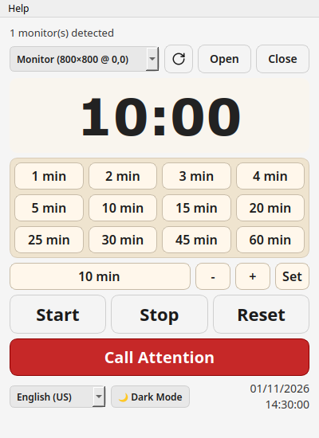
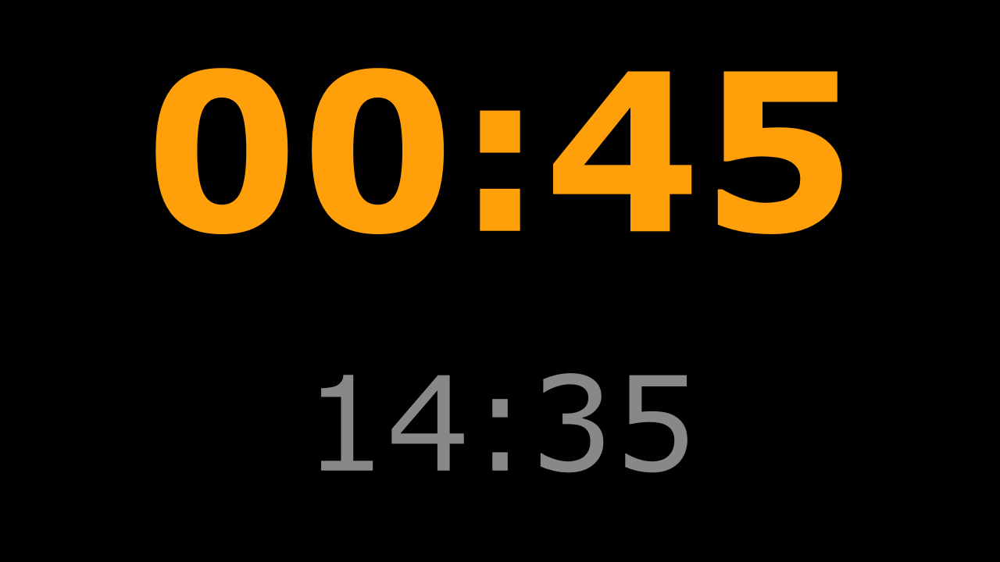

# Chronometer

**Version:** 0.6.0

Chronometer is a desktop countdown timer for presentations and talks. The presenter uses a **control panel**. A separate **output window** shows the remaining time and the current clock time to the speaker or audience, usually on a second monitor or projector.

You can run the Python source code or build an executable for your operating system. Start with [Install and run](#install-and-run) if you are new to the project.

## Contents

- [What the app does](#what-the-app-does)
- [Install and run](#install-and-run)
- [Use the timer](#use-the-timer)
- [Preferences](#preferences)
- [Troubleshooting](#troubleshooting)
- [Platform support and limitations](#platform-support-and-limitations)
- [Build and install an executable](#build-and-install-an-executable)
- [Work on the project](#work-on-the-project)
- [License and credits](#license-and-credits)

## What the app does

- Loads a stopped **10-minute** countdown at startup.
- Offers presets of 1, 2, 3, 4, 5, 10, 15, 20, 25, 30, 45 and 60 minutes.
- Accepts a manual duration from 0 to 180 whole minutes.
- Shows white, orange or red countdown text on the output window according to the remaining time.
- Can flash the output background red and white to call attention.
- Lets you choose the monitor used for the full-screen output.
- Supports Portuguese (Portugal) and English (United States), with language changes during use.
- Saves the control-panel theme, language choice and last output monitor.

The control panel contains the monitor controls, countdown, presets, manual duration, timer buttons and language/theme controls. Its fixed size is 400 × 550, excluding the operating system's window borders. Smaller margins and button padding keep the panel narrow while retaining the main text sizes:



The output has a large countdown and a smaller clock. At 45 seconds, the countdown is orange:



These screenshots were captured with Qt's `offscreen` test backend, which draws windows without a physical screen. Monitor names, fonts and window borders will vary on your computer. The illustrated time and date are examples.

## Install and run

### 1. Check the requirements

You need:

- **Python 3.10 or later**, to run the source code. The automated-check configuration covers Python 3.10, 3.11 and 3.12 on Linux; later versions are outside that matrix.
- **Git**, to download and update this repository.
- A desktop session, to see and interact with the windows.
- A second display only if you want the output on another screen. A single display also works.

Download Python from [python.org](https://www.python.org/downloads/) and Git from [git-scm.com](https://git-scm.com/). On Windows, the current Python Install Manager provides `python` and `py`; older installations may use the legacy `py` launcher. See the [official Windows Python guide](https://docs.python.org/3/using/windows.html) if neither command works.

**Terminal** means the program where you type commands. Use the block for your terminal below. The Windows instructions cover CMD and Git Bash; they are not PowerShell instructions.

### 2. Download the code

These examples create a `projects` folder in your home folder. Run the commands one line at a time.

**Linux — bash:**

```bash
mkdir -p ~/projects
cd ~/projects
git clone https://github.com/adbarbosa/chronometer.git chronometer
cd chronometer
```

**Windows — CMD:**

```cmd
if not exist "%USERPROFILE%\projects" mkdir "%USERPROFILE%\projects"
cd /d "%USERPROFILE%\projects"
git clone https://github.com/adbarbosa/chronometer.git chronometer
cd chronometer
```

**Windows — Git Bash:**

```bash
mkdir -p ~/projects
cd ~/projects
git clone https://github.com/adbarbosa/chronometer.git chronometer
cd chronometer
```

**Expected result:** the current folder contains `README.md`, `__main__.py` and `main_window.py`. This folder is called the **repository root** throughout these guides. Keep its name as `chronometer`: the folder is also the Python package imported by the app. If you downloaded a ZIP, extract it and rename its top-level folder to `chronometer`.

If the folder already exists, do not clone over it. Enter the existing folder and use `git pull` when you want to update an unchanged checkout. If Git reports local changes, review them before updating.

### 3. Create an isolated Python environment

A **virtual environment** is a local folder containing this project's Python packages. It keeps those packages separate from other projects. Create it once, from the repository root.

**Linux — bash:**

```bash
python3 -m venv .venv
source .venv/bin/activate
python -m pip install -r requirements.txt
```

**Windows — CMD:**

```cmd
py -3 -m venv .venv
.venv\Scripts\activate
python -m pip install -r requirements.txt
```

**Windows — Git Bash:**

```bash
py -3 -m venv .venv
source .venv/Scripts/activate
python -m pip install -r requirements.txt
```

`requirements.txt` records validated versions of **PyQt6**, the Python interface to the Qt window and widget toolkit, and its Qt runtime/binding components. Pip installs those versions and their required packages. Development tools are pinned separately in `requirements-dev.txt`; this controls the listed packages, not every transitive dependency or system library.

**Expected result:** package installation finishes without errors. Check the active interpreter and installed toolkit:

```bash
python --version
python -m pip show PyQt6
```

Use `python` for all remaining commands after activating the environment. On Linux, if creating the environment reports that `venv` or `ensurepip` is unavailable, install the Python virtual-environment support provided by your Linux distribution, then repeat this step. An existing environment can usually be reused; do not share it between operating systems.

### 4. Start the app

With the virtual environment active and the current folder set to the repository root, run this in any of the three terminals:

```bash
python __main__.py
```

**Expected result:** the control panel opens at `10:00`, stopped. The output window stays hidden until you select a monitor and press **Open** / **Abrir**.

You can also run `python -m chronometer`, but that form must be run from the folder **containing** the repository. The repository is a Python package; Python needs its parent folder to find it. The direct command above avoids changing directories.

### Start again later

Open a terminal, enter the repository root, activate the existing environment and start the app. For example, on Linux:

```bash
cd ~/projects/chronometer
source .venv/bin/activate
python __main__.py
```

On CMD, use `cd /d "%USERPROFILE%\projects\chronometer"` and `.venv\Scripts\activate`. On Git Bash, use `cd ~/projects/chronometer` and `source .venv/Scripts/activate`. Then run the same `python __main__.py` command.

To leave the virtual environment after closing the app, run `deactivate`.

### Windows shortcut without a terminal

First complete the source installation. Then:

1. Right-click the desktop and choose **New > Shortcut**.
2. Enter the environment's `pythonw.exe` path followed by the entry-point path. Replace `<name>` with your Windows user-folder name and adjust both paths if you installed elsewhere:

   ```text
   "C:\Users\<name>\projects\chronometer\.venv\Scripts\pythonw.exe" "C:\Users\<name>\projects\chronometer\__main__.py"
   ```

3. Name the shortcut **Chronometer**.
4. In its properties, set **Start in** to `C:\Users\<name>\projects\chronometer`.
5. Optionally choose the repository's `icon\chronometer-stopwatch-svgrepo-com.ico` with **Change Icon**.

`pythonw.exe` runs without a console window, so diagnostic messages are harder to see. If the shortcut fails, run `python __main__.py` in an activated terminal first. This shortcut procedure has not been validated on Windows.

## Use the timer

The following labels are English / Portuguese. The interface language is chosen from your saved preference or system language.

### Prepare a presentation

1. Connect the projector or second monitor. In the operating system's display settings, use an **extended desktop** if you want different content on each screen. Duplicated displays show the same desktop.
2. Start Chronometer. Choose the output monitor in the top list. The refresh button reloads that list. The status line reports the actual output visibility; hiding the output with its clock or the operating system also updates that line.
3. Press **Open / Abrir** to show the output full screen on the selected monitor. Changing the list selection alone does not move the output; press Open again.
4. Choose a preset, or edit the manual minutes and press **Set / Definir**.
5. Press **Start / Iniciar** when the presentation begins.

With one monitor, the full-screen output can cover the control panel. Click the smaller clock in the output to hide it and return to the controls.

Long monitor names and output-status text may end with an ellipsis (`…`) to fit the panel. Hold the pointer over the monitor selector or status line to read the complete text in a tooltip. The shortened display does not change the selected monitor.

### Understand the controls

The twelve preset buttons are arranged in three rows of four. All values are minutes:

| Row | Values, from left to right |
|---|---|
| Top | 1, 2, 3, 4 |
| Middle | 5, 10, 15, 20 |
| Bottom | 25, 30, 45, 60 |

| Control or action | Result |
|---|---|
| Duration preset | Stops the countdown and loads that duration. |
| Manual field and `+` / `−` | Edits the proposed duration. The countdown changes only after Set / Definir. |
| Set / Definir | Stops the countdown and loads the manual duration. |
| Start / Iniciar | Starts or resumes a positive remaining time. If a positive loaded duration has reached zero or overtime, starts that loaded duration again. |
| Stop / Parar | Pauses and preserves the remaining time, including the elapsed fraction of a second. |
| Reset / Repor | Stops, restores the loaded duration and ends an attention flash. |
| Call Attention / Chamar Atenção | Flashes the output red and white for approximately two seconds. Does not start, stop or open the output. |
| Close / Fechar near the monitor list | Hides the output; the countdown continues. |
| Click the smaller output clock | Hides the output; the countdown continues. Clicking the large countdown does not hide it. |
| Close the control panel | Closes both windows and ends the app. |

The countdown continues below zero until you stop or reset it. For example, `-00:15` means the presentation is fifteen seconds over its allotted time. Loading zero minutes and pressing Start measures overtime from zero. Starting a positive countdown again after it has expired reloads the original duration.

### Read the output

| Remaining time | Countdown color |
|---|---|
| `01:00` or more | White |
| `00:59` through `00:00` | Orange |
| Below `00:00` | Red |

These warning colors apply to the **output**. The control panel uses its selected theme. The smaller output clock shows local time in `HH:mm`; it continues while the countdown is paused. The attention effect temporarily changes the output background and preserves readable countdown contrast while the time updates or the window is resized.

### Change theme or language

Use the language selector and theme button at the bottom left of the panel. The date and local clock stay together at the bottom right, with the date above the time; both align to the right. They use `dd/MM/yyyy` and `HH:mm:ss`, respectively, and update independently of the countdown.

The light/dark choice applies to the control panel and to the About dialog when it is opened. The monitor refresh symbol follows the panel theme, including when the desktop uses a different theme. The normal output background stays black for either theme.

The language selector updates the interface during use, including the Help menu. The selection is saved immediately. Help / Ajuda contains the About dialog and a link to the project on GitHub.

### Connect or remove a display

The monitor list updates when Qt reports a display being connected or removed. Opening the output explicitly associates it with the selected Qt screen, including when switching an already full-screen output. The refresh button also updates it. When the selected display is unavailable at startup, the app chooses an available alternative. If an output display is removed during use, the app attempts to reopen the visible output on a remaining display.

Windows identifiers now use native monitor interface names. A preference saved with the older identifier format may fall back once after this update; select the intended monitor and press Open to save its new identity.

Display placement depends on the operating system and desktop environment. Test connecting, disconnecting and full-screen placement with your actual presentation equipment before relying on it. Identifiers based on geometry can change when the display arrangement changes.

## Preferences

Preferences are a small JSON text file in your user folder:

- Linux: `~/.chronometer/config.json`
- Windows: normally `C:\Users\<name>\.chronometer\config.json`

For an isolated development or build check, the `CHRONOMETER_CONFIG_DIR` environment variable can select a different preference folder before startup. See the [manual check instructions](CONTRIBUTING.md#run-a-manual-smoke-check). Ordinary use needs no override.

Example of the default values:

```json
{
  "last_monitor_index": 1,
  "last_monitor_id": null,
  "language": null,
  "dark_mode": false
}
```

| Key | Meaning |
|---|---|
| `last_monitor_id` | Identity saved when you open the output. `null` means none has been saved. |
| `last_monitor_index` | Older preference used if the identity cannot be found. Counting starts at zero, so `1` means the second monitor when available. The current interface saves the identity instead of updating this index. |
| `language` | `pt_PT`, `en_US`, or `null` to detect the system language at the next startup. |
| `dark_mode` | `true` for a dark control panel; `false` for a light one. |

The app restores a saved monitor identity first, then tries the older index, then selects the second available monitor or the only monitor. It does not save the active countdown, chosen duration or window visibility. Each new session starts stopped at ten minutes.

Usually you can change preferences through the interface. To edit the file manually, close the app first, use a text editor and preserve valid JSON: double-quoted keys, lowercase `true`/`false`/`null`, and no trailing comma. The language selector has no automatic/system entry; set `language` to `null` manually to restore automatic detection.

To reset all preferences, close the app and rename `config.json` to `config.json.backup`. Start the app again; missing preferences use defaults, and the next preference change creates a new file. Keep the backup until you confirm the result.

Invalid JSON uses defaults without immediately deleting the original file. A later successful preference change replaces it with valid JSON. Wrong theme types use the light default. Empty, whitespace-only or unregistered saved language codes restore automatic detection. Invalid monitor indexes, including negative, fractional and non-finite numbers, use a safe default; older decimal text indexes remain readable.

Each save uses its own temporary file and replaces the final file only after the write is complete. A lock coordinates the entire update between running instances. If the lock cannot be obtained within 250 milliseconds or file access fails, the change is not reported as saved: a translated message appears at the bottom of the panel for six seconds, and the terminal has diagnostic details. The current session remains usable; retry the change when the other writer has finished or after fixing folder permissions.

For automatic language selection, system codes beginning with `pt` use `pt_PT`, and codes beginning with `en` use `en_US`. Other codes can be used when that language is registered. An unregistered system language, failed detection or an absent/damaged requested catalog falls back to Portuguese. The selector reports the language actually applied. If even the Portuguese catalog is unavailable, the original Portuguese strings are used.

## Troubleshooting

Start by opening a terminal, entering the repository root, activating `.venv` and running `python __main__.py`. Keep the error text from that terminal.

| Problem | What to do |
|---|---|
| `python`, `python3` or `py` cannot be found | Revisit the Python installation. Use `python3` on Linux before activation; the Windows examples use `py -3`. Available aliases depend on the installation. Check the official Python guide linked above. |
| `No module named PyQt6` | Activate the environment in this terminal and run `python -m pip install -r requirements.txt`. Check `python -m pip show PyQt6`. |
| `No module named chronometer` | Keep the repository folder named `chronometer`. Run `python __main__.py` inside it, or `python -m chronometer` from its parent. This repository is not currently an installable `pip install -e .` project. |
| Qt reports a display or platform-plugin error | Run in a desktop session. Capture the full Qt error and your Linux distribution/session type; Qt may require system graphics libraries. `offscreen` is for automated checks and does not show usable desktop windows. |
| Output appears on the wrong monitor | Check extended-display settings, refresh the monitor list, select the desired screen and press Open. Test your compositor's full-screen behavior. |
| Output appears to have disappeared | It may have been hidden by Close or by clicking its clock. Press Open again. The countdown may still be running. |
| Preferences are not remembered | Check for the save-failure message at the bottom of the panel. Retry after another instance finishes saving, or fix write access to the preferences folder. Run from a terminal for details. Do not delete a lock file while an instance is writing. |
| Wrong language | Check the saved `language` value. Choosing a language in the interface overrides automatic detection. Developers should also check compiled catalogs; see the translation guide below. |
| Windows blocks the executable | Read the [Windows distribution notes](docs/distribution.md#windows-signing-and-blocks). Signing, reputation and local policy are separate factors. |
| A downloaded executable fails on another Linux machine | The build depends on platform/system libraries. Try the source installation and read the [build guide](docs/distribution.md). |

If the problem remains, report it through the [GitHub issues page](https://github.com/adbarbosa/chronometer/issues). Include the app version, operating system, source/executable launch method, Python and PyQt6 versions when running from source, exact error, reproduction steps and expected result. For monitor issues, include display resolutions, arrangement and whether the session is X11 or Wayland. Remove personal paths or other private details from logs before sharing them.

## Platform support and limitations

Local development and this recorded verification use Linux. Automated checks are configured for Linux and Windows with Python 3.10–3.12, with separate executable build/startup jobs on Python 3.12. Configuring those jobs does not establish that a remote run has completed. Automated GUI tests use a simulated screen; they do not establish that real multi-monitor placement works.

Windows commands and native display integration are provided, and the CI now includes Windows jobs. Actual Windows execution, signing behavior and physical display handling have not been validated by this Linux development environment. macOS is outside the project's current validation scope.

The countdown uses a monotonic clock to avoid accumulating delays from late interface updates. It is not a guarantee of real-time scheduling or identical behavior across system suspension on all operating systems. A blocked interface still cannot repaint until it processes events again.

## Build and install an executable

An executable bundles Python and the app's Python dependencies for one operating system and architecture. Building it is optional if the source installation meets your needs.

Follow [Building, installing and checking executables](docs/distribution.md) for prerequisites, commands, expected output, Linux desktop installation and Windows signing information. The build must be performed on the target operating system. The Windows executable is not signed by this repository's build script.

## Work on the project

- [Contributing](CONTRIBUTING.md): development setup, checks and change workflow.
- [Architecture](docs/architecture.md): how the code and data fit together.
- [Translations](docs/translations.md): update messages or add a language.
- [Distribution](docs/distribution.md): produce and check an executable.
- [Validation record](docs/validation.md): checks performed and their limits.
- [Agent instructions](AGENTS.md): operational rules for coding agents.

## License and credits

The project's own code is under the [MIT License](LICENSE). Dependencies and artwork retain their own licenses; MIT does not replace those terms. See [Third-party components and artwork](docs/third-party.md) for the PyQt/Qt licensing references and icon provenance.
